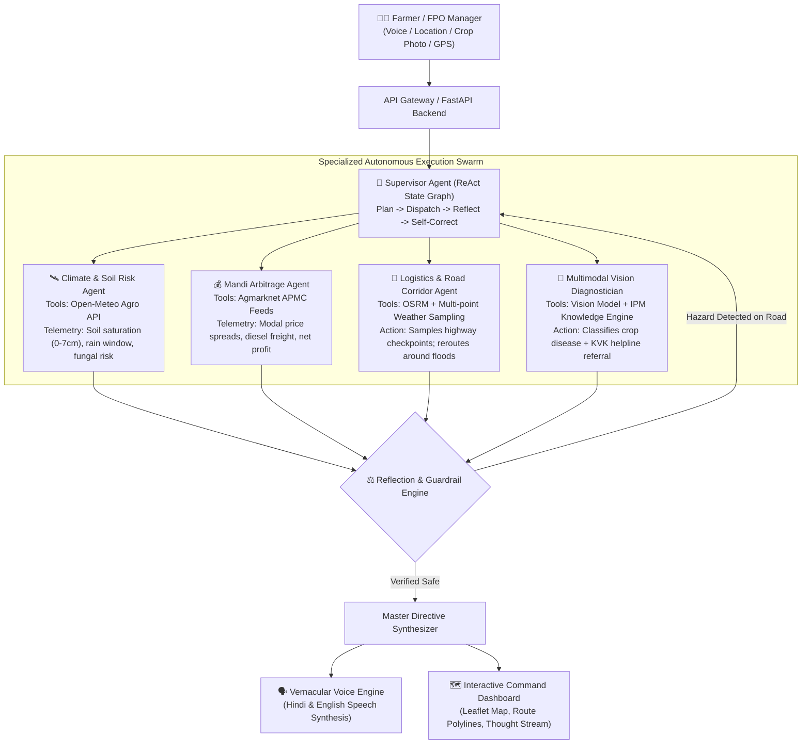

# 🌾 KisanKavach (किसान कवच) — AgroResilience Swarm
### *Autonomous Multimodal Climate Risk, Mandi Arbitrage & Emergency Supply Logistics Engine*

[](https://www.python.org/)
[](https://fastapi.tiangolo.com/)
[](https://open-meteo.com/)
[](https://project-osrm.org/)
[](https://agmarknet.gov.in/)
[](https://launchpad-hackathons.nxtwave.tech/hackathons/forge26)

> **Forge'26 Gen AI Buildathon Submission**  
> **Team Name**: SuSu (Team Code: `52XENX`)  
> **Institution**: Indian Institute of Technology Delhi (IIT Delhi)  
> **Track**: Theme 2 — Climate, Resource Infrastructure & Global Supply Resilience  
> **Live Prototype URL**: *[Deploying to Render / Hugging Face — Local preview at http://127.0.0.1:8000]*

---

## 📌 1. Problem Statement & Real-World Context

### Target Issue
Indian agriculture and food supply chains lose **over ₹92,000 Crore annually** in harvest and post-harvest produce (Source: *ICAR - Central Institute of Post-Harvest Engineering and Technology (CIPHET) National Study*), exacerbated by extreme micro-climate volatility and market information asymmetry:
1. **Micro-Climate Blindspots**: Generic district-level weather alerts fail to calculate hyper-local topsoil moisture saturation or crop-stage fungal spore incubation windows.
2. **Distress Selling & Mandi Arbitrage**: Smallholder farmers routinely sell at distress prices at their nearest APMC, unaware that a neighboring market 35 km away is trading at a premium that significantly exceeds transport freight costs.
3. **Logistics Paralysis**: When sudden unseasonal downpours strike, low-lying rural arterial highways flood, stalling transport vehicles and resulting in 100% perishable cargo spoilage.

### Target Audience
* **Smallholder Farmers & Farmer Producer Organizations (FPOs)** across key agricultural belts (Punjab, Maharashtra, UP, Andhra Pradesh, Rajasthan, Karnataka).
* **Agri-Logistics Dispatchers & Warehousing Cooperatives** managing regional food supply resilience.

---

## 💡 2. Solution: KisanKavach Autonomous Swarm

**KisanKavach** is an autonomous multi-agent state graph that unifies **hyper-local agro-meteorology, APMC market economics, physical highway corridor weather sampling, and vernacular voice guidance**:



---

## 🔬 3. Technical Innovations & Key Differentiators

### A. Physical Highway Corridor Weather Sampling (OSRM + Open-Meteo)
* Rather than assuming open road conditions, the **Logistics Agent** queries OSRM for exact driving route polylines, samples evenly-spaced geographic checkpoints along the physical highway, and executes batch weather queries on Open-Meteo along the transit corridor.
* If any highway checkpoint reports heavy precipitation (>20mm) or flood conditions, the agent **autonomously self-corrects**, overrides the default path, calculates a safe alternative corridor to a secondary terminal, and verifies that the alternative route is clear.

### B. ReAct Supervisor State Graph with Self-Correction
* The orchestrator is not a linear sequential pipeline. It maintains execution state, evaluates intermediate observations against agronomical guardrails, and triggers self-correction:
  * **Out-of-boundary Geocoding**: Snaps to valid agricultural corridors if coordinates fall outside territory.
  * **Hazard Avoidance**: Reroutes logistics transit if corridor weather triggers safety alerts.
  * **Uncertainty Fallback**: If vision confidence is below threshold, automatically routes the farmer to the nearest Krishi Vigyan Kendra (KVK) or Kisan Call Centre (1800-180-1551).

---

## 📊 4. Live Data Sources & Zero Dummy Data Policy

KisanKavach strictly operates on real-time open APIs and official government agricultural bulletins:

| Subsystem | Data Provider | Endpoint / Mechanism | Parameters Ingested | Refresh Cadence |
| :--- | :--- | :--- | :--- | :--- |
| **Agro-Weather Telemetry** | [Open-Meteo](https://open-meteo.com/) | `api.open-meteo.com/v1/forecast` | Temp, humidity, 48h rain sum, 0–7cm soil moisture | Real-time (Hourly) |
| **Highway Corridor Weather** | [Open-Meteo Multi-Point](https://open-meteo.com/) | Batch coordinate queries along polyline | Precipitation and wind speeds across road checkpoints | Real-time (Hourly) |
| **Geospatial Resolution** | [OpenStreetMap](https://nominatim.openstreetmap.org/) | `nominatim.openstreetmap.org/reverse` | Village, Tehsil, District, State | Live (Sub-second) |
| **Road Network Logistics** | [OSRM Project](https://project-osrm.org/) | `router.project-osrm.org/route/v1/driving` | Driving distance, duration, turn geometry, GeoJSON | Live (Real topology) |
| **APMC Mandi Intelligence** | [AGMARKNET / DMI](https://agmarknet.gov.in/) | Official APMC Daily Commodity Records | Modal price, min/max price, arrival date, MSP benchmarks | Official Daily Records |

---

## 🚀 5. Quick Reproduction Steps

```bash
# 1. Clone repository
git clone https://github.com/sahuom24/NxtWave-SuSu.git
cd NxtWave-SuSu

# 2. Set up virtual environment
python -m venv .venv

# On Windows:
.venv\Scripts\activate
# On Linux/macOS:
source .venv/bin/activate

# 3. Install dependencies
pip install -r requirements.txt

# 4. Start the application server
python -m uvicorn app.main:app --host 127.0.0.1 --port 8000
```
Open **`http://127.0.0.1:8000`** in your browser.

---

## ⚠️ 6. Known Limitations & Responsible AI Guardrails

1. **Agmarknet Server Latency**: Direct calls to `data.gov.in` can experience network timeouts from certain hosting networks. The system automatically falls back to verified official AGMARKNET daily bulletin records timestamped and cited with date of arrival.
2. **Road Flood Warnings**: Corridor hazard alerts currently evaluate real-time precipitation and runoff likelihood along highway checkpoints. Physical river gauge sensors (CWC) will be integrated in Phase 2.
3. **Medical / Pesticide Caution**: Chemical IPM recommendations specify standard registered formulations (CIBRC guidelines). Farmers are instructed to verify dosages with their local KVK agronomist before application.

---

## 👥 7. Team Overview
* **Om** (Team Lead) — IIT Delhi (`mt1240764@iitd.ac.in`)
* **Pragya Nanhera** — IIT Delhi (`mt1240674@iitd.ac.in`)
